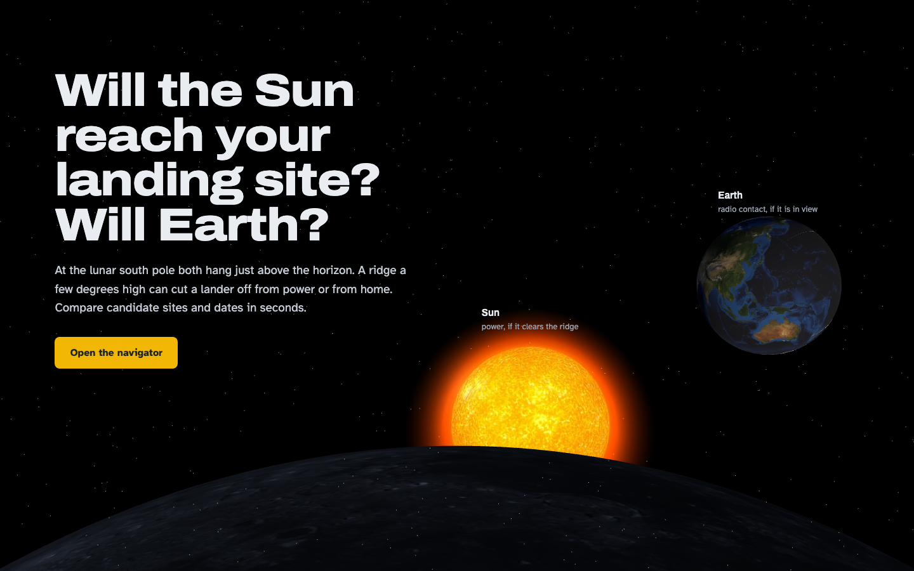
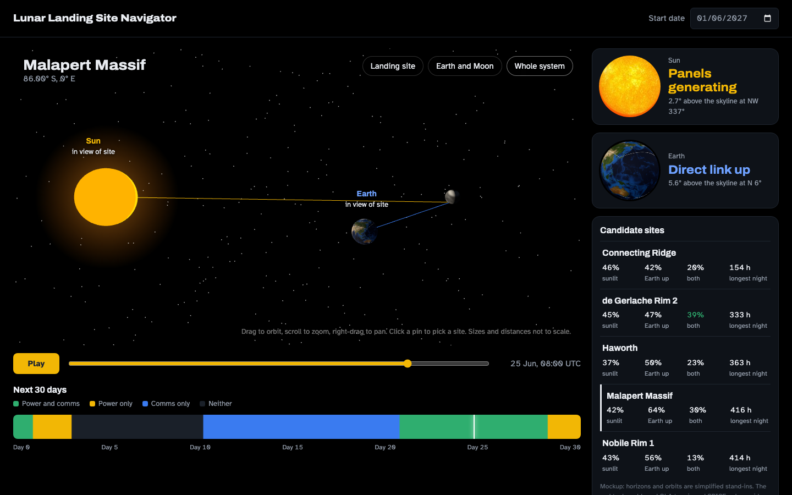
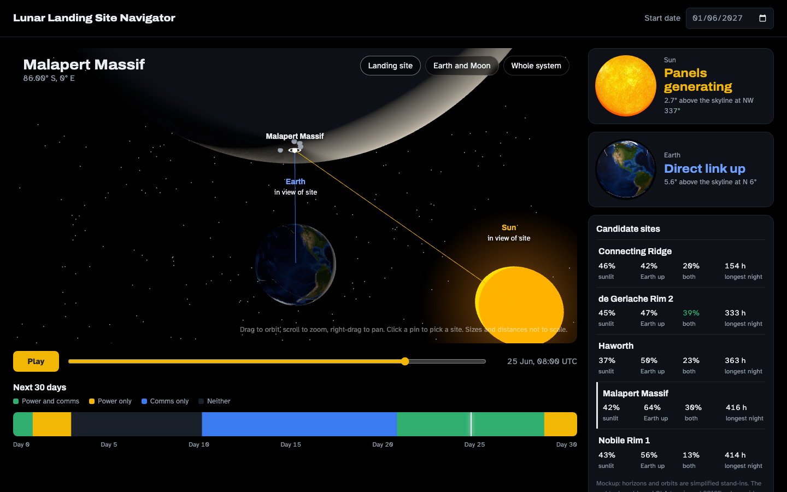
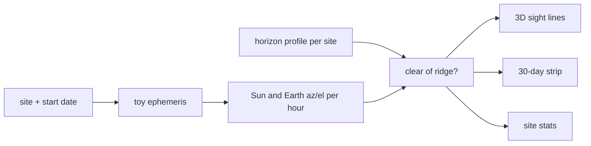

```
 ██╗     ██╗   ██╗███╗   ██╗ █████╗ ██████╗
 ██║     ██║   ██║████╗  ██║██╔══██╗██╔══██╗
 ██║     ██║   ██║██╔██╗ ██║███████║██████╔╝
 ██║     ██║   ██║██║╚██╗██║██╔══██║██╔══██╗
 ███████╗╚██████╔╝██║ ╚████║██║  ██║██║  ██║
 ╚══════╝ ╚═════╝ ╚═╝  ╚═══╝╚═╝  ╚═╝╚═╝  ╚═╝
```

<div align="center">

### `LUNAR LANDING SITE NAVIGATOR // MOCKUP`

*where the Sun and Earth sit relative to a south pole ridge, for any site and any month*


-3a7bf0?style=flat-square&labelColor=111111)
-f2b705?style=flat-square&labelColor=111111)

</div>

---

## 🌒 What is this

A mockup for the **Lunar Landing Site Navigator** challenge at the 2026 NASA Space Apps Challenge. At the Moon's south pole the Sun and Earth both sit a few degrees above the horizon, so a ridge a few degrees high decides whether a lander gets solar power, a direct radio link to Earth, both, or neither. The existing tools answer this, but their interfaces make it slow. This one tries to answer it at a glance.

It has two pages. The homepage puts NASA's Moon along the bottom of the screen, with a Sun sinking behind it and Earth hanging above it, which is the whole problem in one picture. The navigator is a 3D Sun, Earth and Moon you can orbit like Google Earth, with pins on five Artemis III candidate regions and sight lines from the chosen site to the Sun and to Earth that go grey and dashed when terrain blocks them.

The numbers come from a toy model, not real ephemerides, and the 3D view says so. Everything else is ready for real data to replace it.

```console
nick@space-apps-mockup:~$ python3 -m http.server 8743
[✓] serving on :8743. malapert massif has power and comms 30% of june.
[i] de gerlache rim 2 does better. nobody tell malapert.
```

## 🛰️ The navigator

| | feature | what it actually does |
|---|---|---|
| 01 | **orbit view** | drag to orbit, scroll to zoom, right-drag to pan around NASA's Sun, Earth and Moon models |
| 02 | **camera presets** | flies to the landing site, the Earth and Moon pair, or the whole system |
| 03 | **sight lines** | site to Sun in yellow, site to Earth in blue. grey and dashed when the local horizon blocks them |
| 04 | **time scrubber** | play or drag through 30 days: the Sun circles the Moon, Earth wobbles (libration), the terminator moves |
| 05 | **30-day strip** | one colour per hour: power and comms, power only, comms only, neither. click to jump |
| 06 | **site comparison** | sunlit %, Earth in view %, both %, and longest night for each site, best "both" in green |
| 07 | **body cards** | a spinning Sun (Sketchfab) and Earth (NASA) that grey out when hidden behind the ridge |

## 📸 Evidence

| | |
|---|---|
|  |  |
| *the homepage: Moon limb, Sun, Earth* | *whole system view, both sight lines clear* |
|  | |
| *landing site view, looking past Malapert toward Earth* | |

## 🚀 Run it

Needs Python 3 for a local server (the browser blocks loading the `.glb` models from `file://`) and an internet connection for three.js, model-viewer, Google Fonts and the Sketchfab embed.

```bash
git clone https://github.com/nitrimandylis/space-apps-mockup.git
cd space-apps-mockup
python3 -m http.server 8743
```

Then open http://localhost:8743. The models are about 20 MB, so give the first load a second.

## 🔩 Under the hood



| file | path | job |
|---|---|---|
| homepage | `index.html` | three.js hero: NASA Moon limb, NASA Earth, Sketchfab Sun behind a transparent canvas |
| navigator | `navigator.html` | ephemeris, horizon model, orbit view, scrubber, strip, site list, all in one file |
| models | `models/` | NASA Solar System Exploration glTF models of the Sun, Earth and Moon |
| screenshots | `docs/` | the images above |

**What real data replaces:** `terrain()` becomes LOLA horizon masks per site, `bodies()` becomes SPICE ephemerides, and the Moon's texture needs a polar mosaic (the equirectangular map smears at the pole, which is exactly where the sites are).

**Stack:** plain HTML · three.js · model-viewer · NASA glTF models · no build step

---

<div align="center">

**[Nick Trimandylis](https://github.com/nitrimandylis)**

`THE SUN IS ALWAYS SETTING SOMEWHERE AT THE SOUTH POLE`

MIT licensed, see [LICENSE](LICENSE). The 3D models belong to their owners: NASA, and SebastianSosnowski on Sketchfab.

</div>
